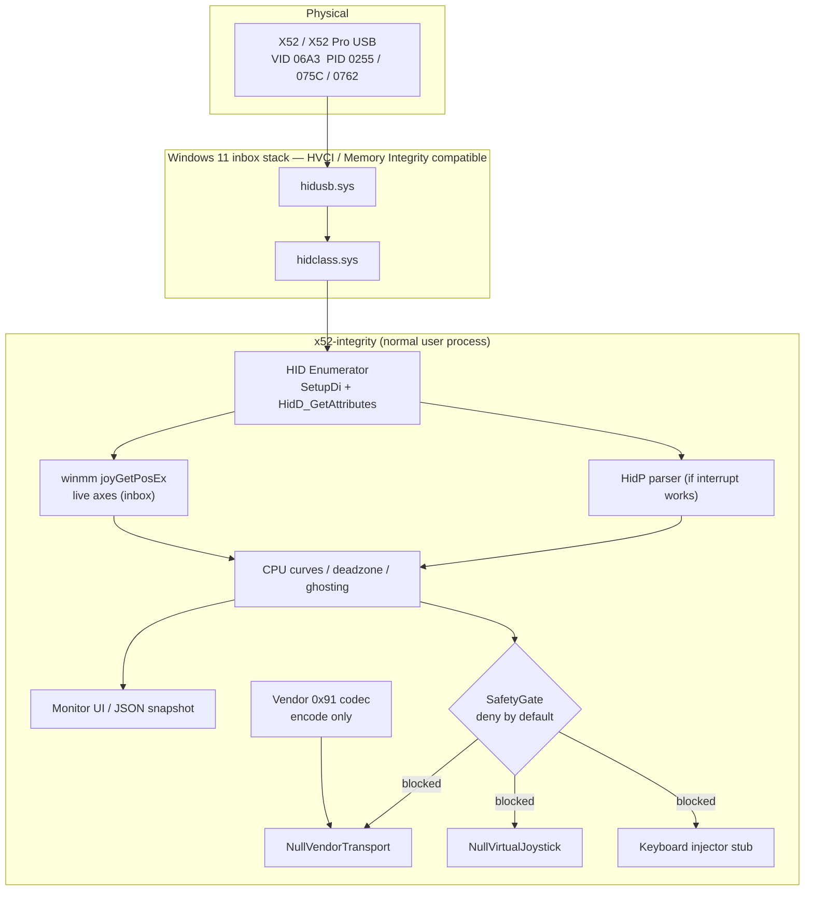

# Architecture

This is **software**, not firmware. The physical X52 keeps its factory firmware. Windows 11 keeps inbox `hidusb.sys` / `hidclass.sys`. Our process runs at normal user privilege and talks HID.

## Read path vs optional write path

Reads are HID identity plus inbox `winmm` live state. No vendor transfers.

On this machine the X52 now uses Windows inbox `input.inf` (`USB Input Device` / `HID-compliant game controller`, function driver `HidUsb`). Logitech `oem237.inf` (SaiK075C / SaiU075C) was exported and removed from the live driver store.

Live stick state is read with inbox `winmm` `joyGetPosEx` (user-space). Windows 11 `hidgamepad.inf` delivers reports to the game-controller stack; a second HID `ReadFile` handle does not see interrupt traffic. That is expected and HVCI-safe.

## Module responsibilities and write policy

| Module | Role | Hardware writes |
|---|---|---|
| `identity` | VID/PID allow-list | none |
| `hid::enumerate` | Find HID interfaces | none |
| `hid::device` | Overlapped `ReadFile` (often silent on W11) | none |
| `hid::decode` | `HidP_GetUsages` / `HidP_GetUsageValue` | none |
| `winmm` | Live axes/buttons via inbox `joyGetPosEx` | none |
| `pipeline` | Deadzone, curves, ghosting in CPU | none |
| `profile` | JSON load; missing safety flags default deny | none |
| `safety` | Runtime latches | refuses every send |
| `vendor::codec` | Builds `(0x91, wValue, wIndex)` | none (pure data) |
| `vendor::transport` | `NullVendorTransport` | always `SafetyError` |
| `output` | `NullVirtualJoystick` | always `SafetyError` |
| `guard` | Restore LEDs/MFD on exit | no-op until a write was issued |
| `diagnose` | Driver stack + Memory Integrity **read** | none |
| `monitor` | Console UI | forces `SafetyGate::monitor_only()` |
| `logbuf` | In-memory + file log ring | none |
| `live` | OS joystick snapshot (`winmm` / evdev) | none |
| `install` | Transactional per-user copy, shortcuts, rollback | none |
| `paths` | `%LOCALAPPDATA%\X52Integrity` / XDG, `X52_INTEGRITY_HOME` | none |
| `config` | First-run + coarse calibration snapshot | none |
| `setup` | Confirmed inbox/Logitech driver switch (Windows) | driver bind only after GUI confirm + UAC |
| `x52-integrity` GUI | Status, live axes, logs, install/remove/test | same as `install` / `setup`; never auto-UAC |

Safe / no-write interfaces:

- `HidReader::read_timeout` / `read_state`
- `ReportDecoder` (via the reader)
- `AxisProcessing::apply`
- `Profile::load`
- `SafetyGate::allow_*` → `Err` in this build
- `VendorTransport::send` on `NullVendorTransport` → `Err`
- `VirtualJoystick::update` on `NullVirtualJoystick` → `Err`

## Optional write features (disabled by default)

Compiled only with `--features write_path`, and still refused at runtime by `SafetyGate::monitor_only()`:

- LED / MFD vendor request `0x91`
- Virtual joystick via **ViGEmBus only** (WHQL). vJoy is not used.
- Keyboard / macro injection

Two extra constraints, even after a future arming change:

1. Every hardware write needs an explicit apply/confirm.
2. We will not rebind the HID function driver to WinUSB to force vendor control transfers. If HID feature reports cannot carry `0x91`, LED/MFD control stays unimplemented rather than installing a kernel helper.

## Windows 11 security

| Feature | How this project treats it |
|---|---|
| Memory Integrity (HVCI) | Compatible: user-space process + inbox HID. We never ask to disable it. |
| Kernel-mode Hardware-enforced Stack Protection | We load no kernel component, so we do not conflict with it. |
| Administrator / UAC | Never requested. |
| Existing Logitech kernel filters | Left installed. `--diagnose` only lists them. Uninstall is a later, confirmed step if those filters are what blocks Memory Integrity. |

## Existing Logitech / Saitek software

Allowed to remain. The HID path is shared (`FILE_SHARE_READ | FILE_SHARE_WRITE`). Uninstalling it can help Memory Integrity if their `.sys` is unsigned for HVCI, but that is **not** part of the first test.
